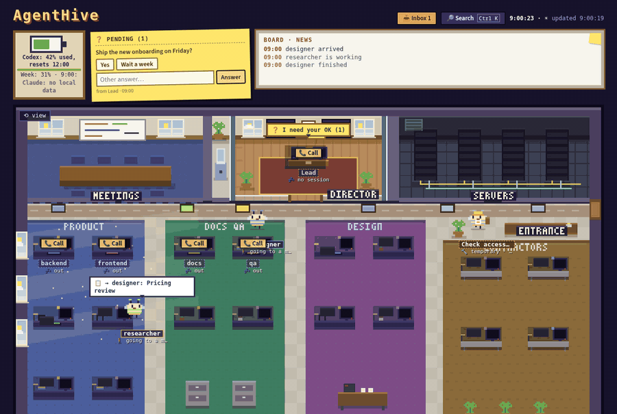
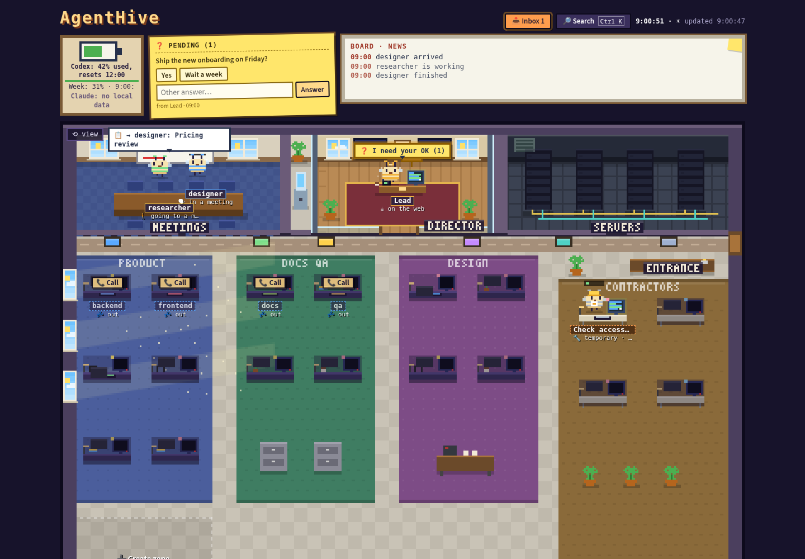
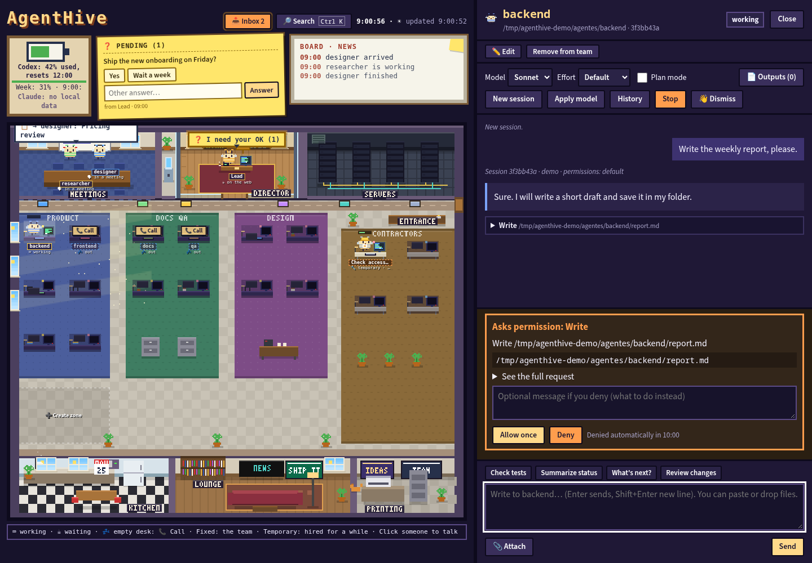
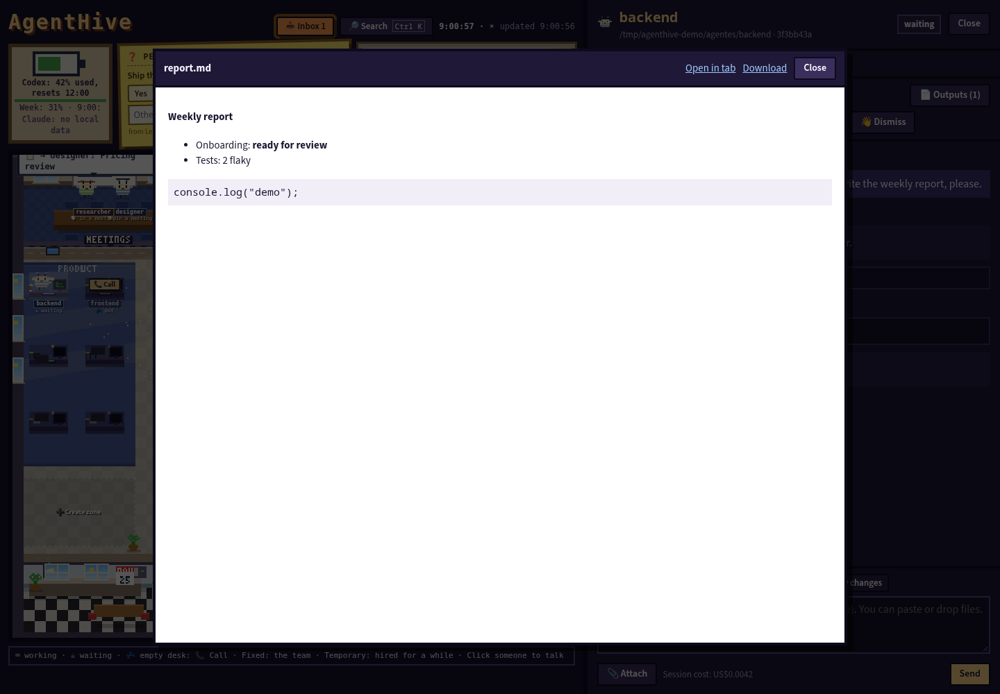
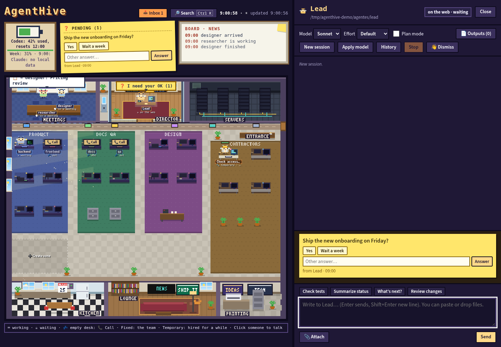
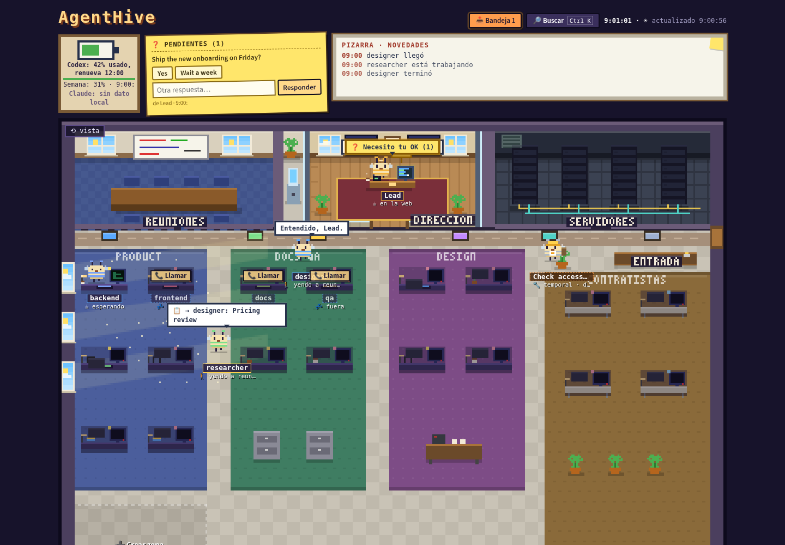

# AgentHive



A local, pixel-art office in your browser for your coding agents, which run on [Claude Code](https://docs.claude.com/en/docs/claude-code). Each agent is a little worker bee at its own desk. Click a desk to call the agent and chat with it the way you would in the terminal. You approve each tool permission yourself, attach files, preview what the agent writes, and see live who is working, waiting or in a meeting.

It runs entirely on your machine (`127.0.0.1`) and uses the official [Claude Agent SDK](https://docs.claude.com/en/docs/agent-sdk/overview) with your existing Claude Code login.



> **Not affiliated.** AgentHive is an independent, unofficial project. It works with Claude Code but is not affiliated with, endorsed or sponsored by Anthropic. Claude and Claude Code are trademarks of Anthropic, PBC.

| Permission cards | Outputs preview | Director thread |
|---|---|---|
|  |  |  |

*All screenshots come from `npm run demo` and show fake data.*

## Features

- **A team you can edit from the office.** Every agent keeps a fixed desk, saved in the config. Clicking an empty desk offers **➕ Create agent here**: name, folder (it must be inside your home folder; hidden folders are refused), model, description and color. Creating an agent doesn't launch it. **✏️ Edit** changes the description, color and model, or moves the agent to another desk. **Remove from team** deletes only the config entry, never the folder or its sessions. Islands grow by rows and contractors get more folding desks as needed, with up to 6 zones in 2 rows.
- **Zones from the office.** The free spot next to the last zone shows **➕ Create zone**: name, floor color (from a readable palette), an optional pattern that places matching sessions there automatically, and an optional **context**. Click a zone's label to edit it. A zone can only be removed when nobody sits in it.
- **Zone and agent context.** A zone's `contexto` (up to 2000 characters, such as «the company website: Astro + Preact, brand rules…»), followed by the agent's own `contexto`, is appended to Claude Code's system prompt when the agent is launched from the web (`systemPrompt: {type: 'preset', preset: 'claude_code', append}`). Its `CLAUDE.md` still applies, and nothing is written into its folder. The agent panel shows this context in a collapsible section. The SDK records a session's system prompt, so a change applies to new sessions, or after the session compacts.
- **Calling agents.** An empty desk shows **📞 Call**. The agent walks in, sits down and its chat opens. It runs in its own folder with its own `CLAUDE.md`, skills and memory, and resumes its last session. **👋 Dismiss** stops it and it walks out.
- **The chat.**
  - replies stream in live;
  - tool calls appear as collapsible cards;
  - you can stop a reply, start a new session or open an older one;
  - you choose model, effort and plan mode;
  - each turn shows its cost and tokens;
  - quick task templates are built in.
- **Permissions, never skipped.** Anything your own Claude Code rules don't already allow shows up as a card: **Allow once** or **Deny** (with an optional message). No answer within 10 minutes means deny. `AskUserQuestion` gets a proper form with its options plus free text.
- **Attachments.**
  - drag and drop or the button;
  - allowed: images, PDF, txt, md, csv, json, docx, xlsx, pptx, zip and code files;
  - limits: 25 MB per file, 10 MB for images;
  - magic bytes are checked where the format has them;
  - images and PDFs go to the model as content blocks; other files are sent as a path the agent can read with its tools.
- **Outputs.** Files the agent creates or edits (`Write`, `Edit`, …) inside its folder appear under **📄 Outputs**:
  - HTML is previewed in a sandboxed iframe (no same-origin access);
  - Markdown is rendered and sanitized;
  - images and PDFs are shown directly;
  - code and text get line numbers;
  - every file has **Open in tab** and **Download**.

  Links to claude.ai artifacts that appear in tool results are shown as cards.
- **The office.**
  - live sessions from `~/.claude/sessions` and their subagents ("temporary" workers);
  - meetings between agents;
  - a news board;
  - an optional Codex quota battery and Codex loops;
  - a day and night cycle.

  All text shown from transcripts is redacted first (emails, tokens, long secrets, phone numbers).
- **Optional director.** This is your main terminal session, the one that coordinates the others. It sits in the Director room.
  - **While it runs in a terminal**, the web never touches it. You talk to it through a mailbox thread: your messages go to `buzon.jsonl` and its replies come from `general.jsonl`. Its questions (`preguntas.jsonl`) appear as cards you answer with one click.
  - **When it isn't running** and you configured a folder for it, you can **📞 Call** it from the web and chat with it directly. Only one director runs at a time.
- **Inbox (📥).** Collects every pending permission and question, shows the count in the tab title and plays a beep.
- **Shortcuts.** **Ctrl+K** searches for an agent; **Esc** closes panels.
- **Interface.** Spanish or English, and a mobile layout (on the same machine).
- **The mascot.** An original worker bee, drawn in a single module (`public/abeja.js`) so it can be swapped. Its stripes take the agent's color, the director wears a crown (honey `#F2B33D` by default, set with `director.color`), temporary workers wear a hard hat, and idle bees doze with drooping antennae.

## Requirements

- **Node.js 22.18 or newer.** TypeScript runs directly, with no build step.
- **Claude Code**, installed and logged in (`claude` works in your terminal). The SDK reuses that login; this app never asks for, reads or stores API keys.
- Linux or macOS. Windows is best effort: it may work, but it isn't tested.

## Install and run

```bash
git clone <this repo> agenthive && cd agenthive
npm install
npm run demo          # try it with fake agents: http://127.0.0.1:8890
cp oficina.config.example.json oficina.config.json   # then edit it
npm start             # your real office
```

To use another port: `PUERTO=8896 npm start`. To use another config file: `npm start -- --config /path/to/config.json` (or `OFICINA_CONFIG=/path`).

## Configuration (`oficina.config.json`)

The file is git-ignored. Without it, the app falls back to `oficina.config.example.json`; the first agent you create or edit from the web then saves your own `oficina.config.json`. The server writes this file atomically (temp file plus rename) and keeps the previous version in `oficina.config.json.bak`. Each agent's desk is stored as `puesto: {zona, i}`: when an agent has none, the server guesses a desk once and saves it. Paths may start with `~/` (your home folder) or `{tmp}/` (the OS temp folder).

| Key | Meaning |
|---|---|
| `titulo` | Page title ("Oficina" by default) |
| `idioma` | `"es"`, `"en"` or `"auto"` (browser language) |
| `puerto` | Port (8890 by default) |
| `agentes[]` | `nombre` (lowercase, digits and dashes), `carpeta` (the only folder it runs in), `color`, `modelo` (`opus`/`sonnet`/`haiku`), `descripcion`, optional `contexto` (≤ 2000, appended after its zone's), `zona` (0–5, used to guess a desk) and `puesto` (`{zona, i}`, written by the server) |
| `director` | Optional. `nombre`, `patronSesion` (e.g. `"lead-*"`, matched against Claude Code session names), optional `carpeta` and `modelo` so it can be launched from the web, and `color` (its crown; `#F2B33D` by default) |
| `coordinacion.dir` | Where `buzon.jsonl`, `preguntas.jsonl` and `general.jsonl` live (`tmp/coordinacion` by default) |
| `oficina` | `zonas[]` (1 to 6 × `{nombre, color?, patron?, contexto?}`, in 2 rows; `color` comes from the built-in palette, and `contexto` is a brief appended to the prompt of every agent in the zone; `patron` is a regex matched against name and folder), `carteles[]` (3 posters: `{texto, fondo, color}`), `tv` |
| `codex` | `cupo: true` shows the Codex quota from `~/.codex/sessions`. `bucles[]` lists Codex loop scripts to show: `{nombre, script, marcador, textoHecho, vueltas}` |

### Mailbox file formats (one JSON object per line)

- **`buzon.jsonl`**, written by the app:
  - a message: `{"id","ts","to","texto","estado":"pendiente"}`;
  - to the director, add `"imagenes":[abs paths]` and/or `"adjuntos":[abs paths]`;
  - an answer: `{…,"to":"<director>","texto":"Answer to «…»: …","pregunta_id","estado":"pendiente"}`.
- **`preguntas.jsonl`:**
  - the director asks: `{"id","ts","de","texto","estado":"pendiente","opciones"?:[…]}`;
  - the app answers: `{"id","estado":"respondida","respuesta","ts"}`.
- **`general.jsonl`**, the director's replies: `{"id","ts","texto","responde_a"?}`. Markdown is allowed and is escaped when shown.

### Start at login (optional)

See `contrib/`:

- `linux/agenthive.service`: a systemd user unit.
- `linux/agenthive.desktop`: an XDG autostart entry that waits for the port, then opens the browser.
- `macos/com.example.agenthive.plist`: a launchd agent.

Instructions are inside each file.

## Security model

- **Network.**
  - Listens on `127.0.0.1` only. There is no LAN mode.
  - A random token is generated on each start and delivered only inside the served page. It's required for the WebSocket and every POST.
  - `Host` must match exactly on every request (blocks DNS rebinding), and `Origin` must match exactly on every POST and WebSocket.
  - No CORS. Strict CSP: only first-party scripts, no inline scripts.
- **Agents.**
  - Always `permissionMode: "default"` plus `canUseTool`, so anything your rules don't allow waits for your click.
  - The app never uses `bypassPermissions`, `acceptEdits` or auto-approval.
  - Only roster agents (and the configured director) can be launched, and only in their own folder.
  - Creating an agent from the web (`POST /agentes`, same token, Origin and Host checks) requires an existing folder inside your home folder: not the home folder itself, nothing outside it after resolving symlinks, and no hidden segment such as `.ssh`, `.config`, `.claude`, `.codex`, `.gnupg` or `.local/share/keyrings`. The director and Codex loops can't be created or removed from the web.
  - Sessions live in a terminal are never resumed or attached to.
- **Files.**
  - Uploads go to `tmp/subidas/<chat>/`, are wiped on every start, and are re-validated when used.
  - Previews require a per-file HMAC signature and must resolve (following symlinks) inside the agent's folder or the app's `tmp/`.
  - HTML is served only through `/vista`, with `CSP: sandbox allow-scripts`, and the iframe has no `allow-same-origin`. Other files are served with `CSP: sandbox` and `nosniff`.
- **Displayed text.** Everything shown from agents, transcripts and files is escaped before formatting. Markdown is minimal and links are http(s) only.
- **Never touched.**
  - credential files (only the small `~/.claude/sessions/<pid>.json` metadata files are read, never the `.key` files);
  - Claude Code settings and permissions.

## Limitations

- **Artifacts.** The `Artifact` tool isn't exposed to Agent SDK sessions (checked with CLI 2.1.332). Artifact cards only appear when some tool result contains a claude.ai artifact link, for example from a claude.ai connector.
- **Outputs.** Only files written with `Write`, `Edit`, `MultiEdit` and `NotebookEdit` are detected. Files created through `Bash` are not.
- **Matching.** Live terminal sessions are matched to agents by session name (`/rename`, or the `--name` given at launch).
- **Uploads.** Uploads are wiped on restart. Files sent to the director are kept in `tmp/para-general/`.
- **Server language.** Server messages use the configured language; `"auto"` means English on the server side.

## Not affiliated

AgentHive is an independent, unofficial project. It works with Claude Code but is not affiliated with, endorsed or sponsored by Anthropic. Claude and Claude Code are trademarks of Anthropic, PBC. The bee mascot is original to this project.

## License

MIT. See [LICENSE](LICENSE). Contributions are welcome; see [CONTRIBUTING.md](CONTRIBUTING.md).

---

## En español

**AgentHive** («colmena de agentes») es una oficina pixel art local en el navegador para tus agentes, que funcionan con Claude Code. Cada agente es una abeja obrera con su escritorio: con un clic lo llamas, le hablas como en la terminal, apruebas cada permiso, le adjuntas archivos y ves lo que escribe.



- **Requisitos:** Node 22.18 o más nuevo y Claude Code instalado con sesión iniciada. La app usa ese login; no pide llaves.
- **Probar:** `npm install && npm run demo`. Son agentes de mentira y no llaman a Claude.
- **Equipo:** cada agente tiene su escritorio fijo, guardado en la config. En un escritorio vacío aparece «➕ Crear agente aquí»; en el panel de cada agente están «Editar» y «Quitar del equipo». Quitar solo lo borra de la config.
- **Zonas y contexto:** en el lugar libre aparece «➕ Crear zona», con nombre, color, patrón y contexto; para editarla, haz clic en su nombre. El `contexto` de la zona, y después el del agente, se **añade** al prompt de Claude Code al llamar al agente desde la web: su CLAUDE.md sigue igual y no se escribe nada en su carpeta. El contexto se ve en el panel del agente. Como el SDK fija el prompt de cada sesión, un cambio vale para sesiones nuevas o después de compactar.
- **Usar:** copia `oficina.config.example.json` a `oficina.config.json`, pon tus agentes y sus carpetas, y corre `npm start`. Abre <http://127.0.0.1:8890>.
- **Director (opcional):** es tu sesión principal de terminal. Mientras está en la terminal, le escribes por el buzón y respondes sus preguntas desde la oficina. Si no está corriendo y tiene `carpeta`, lo llamas desde la web.
- **Seguridad:**
  - escucha solo en 127.0.0.1;
  - un token por arranque;
  - Host y Origin exactos;
  - los permisos los apruebas siempre tú;
  - no lee credenciales ni toca la configuración de Claude Code.
- **Arranque al iniciar sesión:** ejemplos en `contrib/` (systemd, .desktop y launchd).
- **Sin afiliación:** AgentHive es un proyecto independiente y no oficial. Funciona con Claude Code, pero no está afiliado a Anthropic ni cuenta con su respaldo o patrocinio. Claude y Claude Code son marcas registradas de Anthropic, PBC. La abeja es una mascota original de este proyecto.
